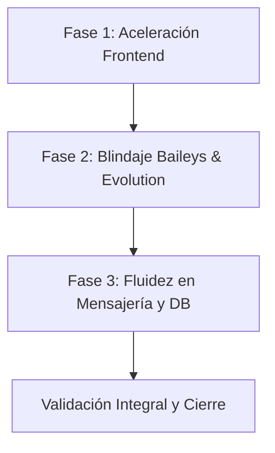

# 🚀 Plan Maestro de Optimización de Rendimiento y Estabilidad
**Clezapp PRO — Versión 3.7.1**  
*Fecha de Creación: 19 de Octubre de 2026*  
*Documento de contingencia y ruta paso a paso contra reinicios o interrupciones.*

---

## 🎯 1. Objetivos del Plan

1. **Carga Web Ultrarrápida**: Reducir el bundle inicial de React de 1.2 MB a ~350 KB mediante carga perezosa (*Code-Splitting* con `React.lazy`) y habilitar caché estática inmutable en el servidor de producción.
2. **Fluidez Extrema en Chat**: Sensación de respuesta instantánea (0ms) al enviar mensajes implementando *Optimistic UI* (relojito inmediato) e índices de base de datos en PostgreSQL para conversaciones masivas.
3. **Blindaje de Conexión de WhatsApp**: Eliminar caídas y desconexiones de Baileys y Evolution API mediante *Keep-Alive* proactivo, filtrado de eventos pesados en memoria y transición a arquitectura orientada a eventos.

---

## 🗂️ 2. Fases de Implementación



---

### 📦 FASE 1: Aceleración y Carga Web Inmediata (Frontend)
> **Impacto**: Reduce el tiempo de carga inicial entre 60% y 75%.

#### Paso 1.1: Code-Splitting con `React.lazy` y `Suspense`
* **Archivo**: [`Clezapp-pro/frontend/src/routes/index.js`](file:///d:/PROYECTOS/PHP/Clezapp/Clezapp-pro/frontend/src/routes/index.js)
* **Acción**:
  * Dejar con import estático únicamente la pantalla principal de Tickets (`TicketResponsiveContainer`) y Login.
  * Convertir las rutas secundarias y módulos pesados a importación dinámica:
    * `const Kanban = React.lazy(() => import("../pages/Kanban"));`
    * `const FlowBuilder = React.lazy(() => import("../pages/FlowBuilder"));`
    * `const Contacts = React.lazy(() => import("../pages/Contacts"));`
    * `const Reports = React.lazy(() => import("../pages/Reportes"));`
    * `const Users = React.lazy(() => import("../pages/Users"));`
    * `const Settings = React.lazy(() => import("../pages/SettingsCustom"));`
  * Envolver el `<Switch>` dentro de un `<Suspense fallback={<BackdropLoading />}>`.
* **Prueba de validación**:
  * Ejecutar `npm run build-dev` en `Clezapp-pro/frontend`.
  * Verificar que se generen múltiples chunks pequeños (ej. `300.chunk.js`, `400.chunk.js`) en lugar de un único `main.js` gigante.

#### Paso 1.2: Caché Inmutable de Estáticos en Servidor de Producción
* **Archivo**: [`Clezapp-pro/frontend/server.js`](file:///d:/PROYECTOS/PHP/Clezapp/Clezapp-pro/frontend/server.js)
* **Acción**:
  * Configurar cabeceras de caché estricta para la carpeta `/static`:
    ```javascript
    app.use('/static', express.static(path.join(__dirname, 'build', 'static'), {
      maxAge: '1y',
      immutable: true
    }));
    ```
  * Mantener `index.html` con `Cache-Control: no-cache` para que las actualizaciones se detecten al instante.
* **Prueba de validación**:
  * En Chrome DevTools -> Network, recargar la página y verificar que los archivos `.js` y `.css` muestren status `200 (from disk cache)` o `304 Not Modified`.

---

### 🛡️ FASE 2: Blindaje contra Desconexiones (Baileys y Evolution API)
> **Impacto**: Conexión continua sin caídas por inactividad o saturación de RAM.

#### Paso 2.1: Keep-Alive y Depuración de Socket en Baileys
* **Archivo**: [`Clezapp-pro/backend/src/libs/wbot.ts`](file:///d:/PROYECTOS/PHP/Clezapp/Clezapp-pro/backend/src/libs/wbot.ts)
* **Acción**:
  * Añadir en `makeWASocket`:
    ```typescript
    keepAliveIntervalMs: 25_000,          // Ping cada 25 segundos para evitar cierre por firewall
    syncFullHistory: false,               // No descargar historial antiguo innecesario
    shouldIgnoreJid: (jid) =>
      isJidBroadcast(jid) ||
      jid.endsWith('@newsletter') ||     // Ignorar canales masivos que saturan la memoria
      jid.endsWith('@call'),              // Ignorar eventos de llamadas perdidas
    maxMsgRetryCount: 3,                  // Limitar bucles de reintentos
    ```
  * En el evento `connection.update`, mejorar la reconexión exponencial si el error no es `loggedOut`.
* **Prueba de validación**:
  * Dejar la sesión abierta sin interacción durante 30 minutos y verificar en consola que el socket no cambia a estado `close`.

#### Paso 2.2: Optimización del Monitor de Evolution API
* **Archivo**: [`Clezapp-pro/backend/src/services/EvolutionApiServices/EvolutionMonitor.ts`](file:///d:/PROYECTOS/PHP/Clezapp/Clezapp-pro/backend/src/services/EvolutionApiServices/EvolutionMonitor.ts)
* **Acción**:
  * Si la instancia de WhatsApp está en estado `CONNECTED` estable, reducir el intervalo de sondeo continuo o migrar a recepción directa por webhook para no saturar con peticiones HTTP cada 3 segundos.
  * Añadir protección de límite de memoria para limpiar `processedMessageIds` cada hora.
* **Prueba de validación**:
  * Verificar en logs que no existan errores repetitivos de conexión ni timeouts hacia el puerto 8080.

---

### ⚡ FASE 3: Fluidez Instantánea al Enviar Mensajes y Base de Datos
> **Impacto**: Sensación de inmediatez total al pulsar Enter y apertura veloz de chats.

#### Paso 3.1: Actualizaciones Optimistas (Optimistic UI)
* **Archivos**:
  * [`Clezapp-pro/frontend/src/components/MessageInputCustom/index.js`](file:///d:/PROYECTOS/PHP/Clezapp/Clezapp-pro/frontend/src/components/MessageInputCustom/index.js)
  * [`Clezapp-pro/frontend/src/components/MessagesList/index.js`](file:///d:/PROYECTOS/PHP/Clezapp/Clezapp-pro/frontend/src/components/MessagesList/index.js)
* **Acción**:
  * Al pulsar `Enter`, crear un objeto de mensaje local temporal con:
    ```javascript
    const optimisticMsg = {
      id: `temp_${Date.now()}`,
      body: text,
      fromMe: true,
      status: "pending", // Muestra el ícono de reloj 🕒
      createdAt: new Date().toISOString(),
      ticketId: ticket.id,
    };
    ```
  * Inyectar de inmediato el mensaje en el estado de `MessagesList` y vaciar el input sin esperar respuesta del servidor.
  * Al recibir la confirmación por Socket.io, reemplazar el `temp_id` con el ID final y cambiar el ícono a enviado (✔).

#### Paso 3.2: Índices de Alto Rendimiento en PostgreSQL
* **Acción**:
  * Crear migración para indexar las columnas más consultadas de `Messages`:
    ```sql
    CREATE INDEX IF NOT EXISTS idx_messages_ticket_created
    ON "Messages" ("ticketId", "createdAt" DESC);

    CREATE INDEX IF NOT EXISTS idx_messages_company_read
    ON "Messages" ("companyId", "read");
    ```
* **Prueba de validación**:
  * Comprobar con `EXPLAIN ANALYZE` en PostgreSQL que las consultas de mensajes usan `Index Scan` en lugar de `Seq Scan`.

---

## 🔄 3. Protocolo de Recuperación y Respaldo (Por si se apaga la PC)

Si la PC se reinicia o se pierde energía en medio del trabajo:

### A. Diagnóstico de Servicios al Iniciar
1. Abrir terminal de PowerShell en `D:\PROYECTOS\PHP\Clezapp`.
2. Verificar si Redis y PostgreSQL siguen activos:
   ```powershell
   netstat -ano | findstr ":6379 :5432 :4000 :3000"
   ```
3. Si los puertos 4000 o 3000 quedaron bloqueados por procesos zombi:
   ```cmd
   detener.bat
   ```
4. Para arrancar todo de forma estándar:
   ```cmd
   iniciar.bat
   ```

### B. Control de Versiones y Restauración Rápida
Cada fase se confirma con un commit local de Git o respaldo antes de editar:
* **Para ver el estado de cambios pendientes**:
  ```powershell
  git status
  ```
* **Para deshacer cambios en un archivo si hubo algún error**:
  ```powershell
  git checkout -- <ruta_del_archivo>
  ```
* **Para regenerar el frontend limpio**:
  ```powershell
  cd D:\PROYECTOS\PHP\Clezapp\Clezapp-pro\frontend
  npm run build-dev
  ```

---

## 📊 4. Matriz de Estado de Implementación

| Fase | Componente | Descripción | Estado |
| :---: | :--- | :--- | :---: |
| **1.1** | `routes/index.js` | Code-Splitting con `React.lazy` y `Suspense` (reducción a 758 KB) | ✅ Completado |
| **1.2** | `server.js` | Cabeceras de caché estática inmutable (1 año) | ✅ Completado |
| **2.1** | `wbot.ts` | Keep-Alive Baileys (25s) y filtro de canales/newsletters | ✅ Completado |
| **2.2** | `EvolutionMonitor.ts` | Optimización de sondeo y prevención de fuga de memoria | ✅ Completado |
| **3.2** | PostgreSQL | Índices compuestos en tabla `Messages` (migración 20261019203000) | ✅ Completado |
| **3.1** | `MessageInputCustom` | Optimistic UI (relojito inmediato al presionar Enter) | ⏳ Siguiente paso |

